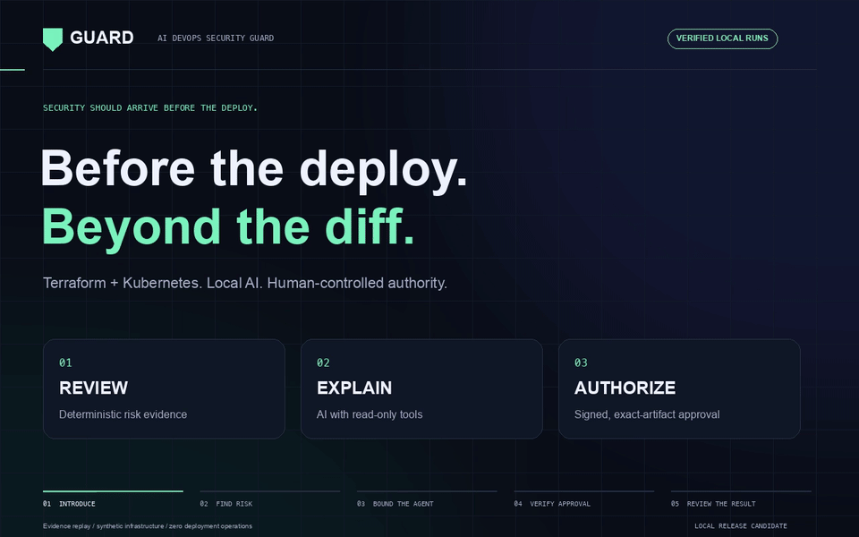
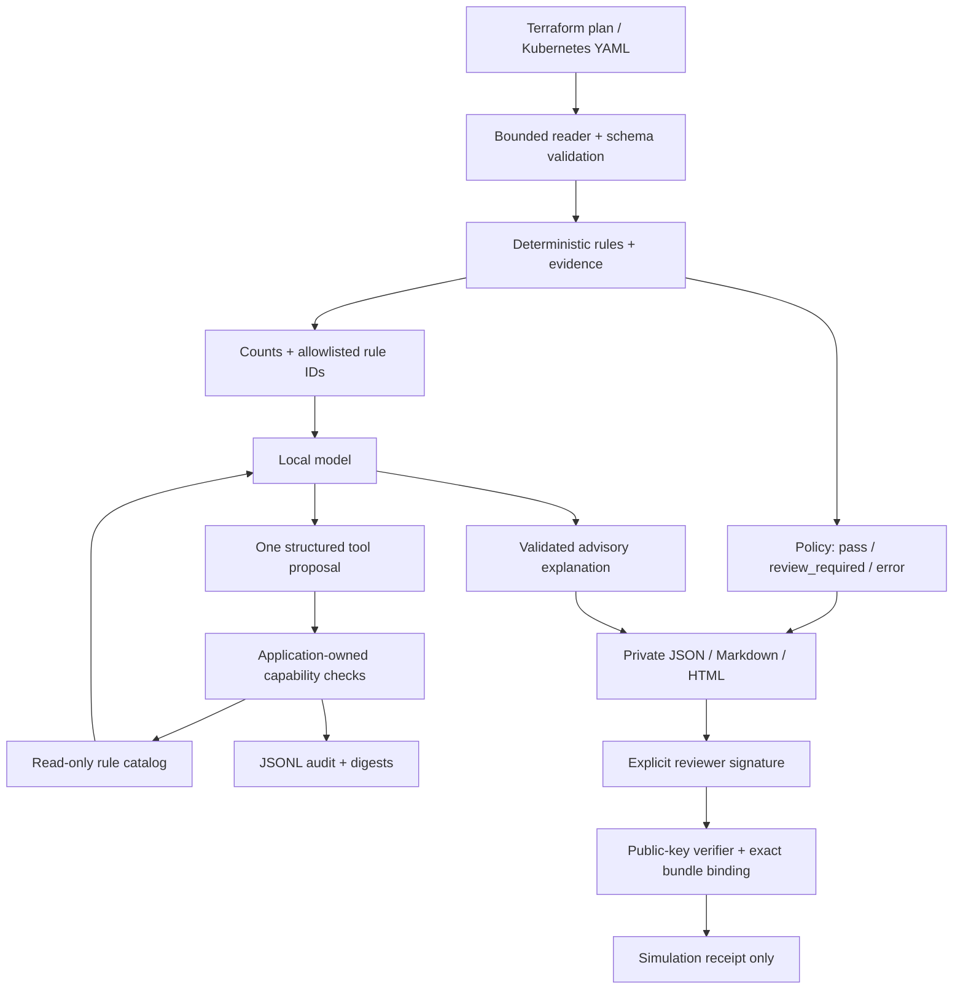

# AI DevOps Security Guard

**Review the risk. Own the decision.**

[](https://github.com/yonatani94/ai-devops-security-guard/actions/workflows/ci.yml)

A read-only, AI-assisted reviewer for Terraform plans and Kubernetes manifests.
Deterministic checks establish findings. A bounded local AI worker explains them.
Human approval remains a separate, artifact-bound capability.
Choose native local inference or your company's compatible AI gateway without
changing the rules, tool permissions, policy, or approval flow.



[Watch the 22-second video](docs/media/guard-demo.mp4) ·
[Inspect actual run evidence](docs/demo-evidence/proof.json) ·
[Threat model](docs/threat-model.md) · [Approval demo](docs/approval-demo.md)
· [Bring your own AI provider](docs/providers.md)

**Status:** public v0.3.0 code, MIT licensed, with [verified hosted CI](https://github.com/yonatani94/ai-devops-security-guard/actions/runs/41346712622).
The protected-approval workflow has separate independent and synthetic-only
solo-demo modes, both configured with `yonatani94` as reviewer. Solo mode permits
the owner to review their own tests; independent mode still prevents self-review.
The [protected solo-demo run](https://github.com/yonatani94/ai-devops-security-guard/actions/runs/41349300579)
was approved by `yonatani94` and completed successfully; its
[verified receipt](docs/hosted-approval/evidence.json) records zero infrastructure operations.
The animation replays actual local results; it is not a screen recording.
The automated demo signer is explicitly not a real human approval. No cloud
infrastructure is deployed and no production credentials are needed.

## Business value

Infrastructure changes can introduce public access, excessive permissions, or
privileged workloads before an application is deployed. GUARD gives platform and
security teams a consistent CI checkpoint to identify supported risks, explain
their impact, and route findings to a human reviewer before changes proceed.

- **Catch infrastructure exposure earlier:** flag public SSH, wildcard IAM/RBAC
  permissions, privileged Kubernetes containers, and host namespace sharing in the supported inputs.
- **Make reviews easier to act on:** pair deterministic findings with AI-assisted
  explanations and remediation guidance.
- **Keep decisions accountable:** retain review evidence, audit tool calls, and
  bind approval to the exact reviewed artifacts.
- **Use the company's AI platform:** choose local inference or a compatible
  approved gateway through configuration.

The scope is infrastructure configuration security. Reviewing application source,
business logic, customer records, or runtime traffic is outside this tool's scope.
No application data is required for the review.

### Data boundaries

Raw Terraform plans and Kubernetes manifests are parsed locally. The AI receives
only finding counts, coverage-gap counts, supported rule IDs, and trusted static
rule guidance. It receives no raw configuration, resource identifiers, application
source, or secret values through this context contract.

Infrastructure inputs can still contain sensitive information. Local reports retain
resource identifiers, and input files and CI artifacts need restricted access and
retention. This is data minimization at the AI boundary, not a guarantee that every
input or generated artifact is free of sensitive data. The current examples and
approval demos use synthetic inputs only.

For a pilot, measure actionable findings, review turnaround, and reviewer acceptance
of explanations. Reduced incident rates or cost savings have not yet been measured.

[Reusable CI integration](docs/ci-integration.md) ·
[Data boundaries](docs/data-boundaries.md) · [Pilot scorecard](docs/pilot-scorecard.md)

## What it demonstrates

- AI-assisted infrastructure review with real local Ollama inference, plus a fake
  provider for repeatable offline tests.
- Provider-independent structured worker, native Ollama and a configurable company
  gateway adapter, with shared contract tests and live local wire-protocol evaluations.
- Least-privilege capabilities: the model can request one known-rule lookup and
  cannot read arbitrary files, invoke a shell, approve, or deploy.
- Audited model tool proposals, permitted/denied calls, arguments from a closed
  vocabulary, UTC correlation IDs, durations, and SHA256 bindings.
- Fail-closed policy: findings require review; unknown or unsupported analysis is
  an error and stops before inference. Model/provider failures never become passes.
- Signed local approval and a public-key-only verification demo, with exact bundle
  binding, expiry, changed-input rejection, and local replay protection.
- A secret-free reusable GitHub Actions review with confined input paths, a pinned
  trusted implementation, and opt-in report uploads. Hosted safe calls pass and
  risky or incomplete fixtures block.
- GitHub Actions CI plus a manual, main-only protected-environment demo that checks
  actual required-reviewer configuration before continuing.
- Private JSON/Markdown reports and a script-free, responsive HTML review surface.

## Try it

Requires Python 3.12+ on Linux/macOS and [uv](https://docs.astral.sh/uv/).
The development environment and CI select Python 3.12.

```bash
uv sync --locked

# Credential-free, deterministic demo. Expected exit code: 1 (review required).
uv run ai-devops-guard review \
  --plan examples/terraform/risky.plan.json \
  --ai-provider fake --output-dir artifacts/demo

# Kubernetes input uses the same policy, AI and audit interfaces.
uv run ai-devops-guard review \
  --manifest examples/kubernetes/risky.yaml \
  --ai-provider fake --output-dir artifacts/kubernetes
```

Each invocation prints a fresh run directory containing `report.json`, `report.md`,
`report.html`, and `audit.jsonl`. Open `report.html` locally to inspect findings,
expand evidence/remediation, and inspect the agent trace. Reports retain resource
identifiers: treat real reports as private. Nothing uploads them automatically.

On the existing development workstation, `./.venv/bin/ai-devops-guard` and
`./.venv/bin/uv` also work without changing PATH.

| Input/result | Decision | Exit code |
| --- | --- | --- |
| `examples/terraform/safe.plan.json` | `pass` within supported checks | `0` |
| `examples/terraform/risky.plan.json` | `review_required` | `1` |
| `examples/terraform/unknown.plan.json` | `error`, AI not run | `2` |
| `examples/kubernetes/safe.yaml` | `pass` within supported checks | `0` |
| `examples/kubernetes/risky.yaml` | `review_required` | `1` |
| Malformed input, failed inference, audit/report failure | `error` or aborted run | `2` |

A passing review is not permission to deploy. Even the local simulation requires
an explicit signed approval. Report persistence failures can leave partial files:
consumers must check the process exit code and run ID, not merely file presence.

## Your company's AI provider

Provider, endpoint, model/deployment, response format, timeout and output budget are
configured in TOML. Tokens are supplied only through `GUARD_AI_TOKEN`; the separate
trusted `GUARD_ALLOWED_AI_HOSTS` setting restricts HTTPS destinations. There is no
automatic provider fallback or capability downgrade.

```bash
# Exercise the company-facing wire protocol locally, with no cloud credential.
uv run ai-devops-guard review \
  --plan examples/terraform/risky.plan.json \
  --ai-config examples/config/local-gateway.toml \
  --output-dir artifacts/compatible-ai
```

For a company endpoint, adapt `examples/config/company-gateway.toml` and inject
credentials/host policy from a trusted CI job. The compatible adapter supports
Chat Completions JSON responses, bearer or API-key headers, and explicit schema
capabilities. It does not claim universal compatibility with native provider APIs.
Both native and compatible transports were live-tested against local Ollama;
company-hosted authentication and model access require their own integration run.
See [provider setup, boundaries and extension guidance](docs/providers.md).

## Real local AI

Install [Ollama](https://docs.ollama.com/) from its official source, start its local
service, and download a model. The verified demo uses the approximately 986 MB
[Qwen2.5 1.5B model](https://ollama.com/library/qwen2.5:1.5b), licensed Apache 2.0.
Weights are not distributed in this repository.

```bash
ollama pull qwen2.5:1.5b
uv run ai-devops-guard review \
  --plan examples/terraform/risky.plan.json \
  --ai-provider ollama --model qwen2.5:1.5b --timeout 60 \
  --output-dir artifacts/real-ai
```

The worker uses [Ollama structured outputs](https://docs.ollama.com/capabilities/structured-outputs)
for a single tool proposal, then a short explanation. The dispatcher independently
checks caller identity, tool name, argument schema, and active rule scope. There
are at most two HTTP requests, one read-only lookup, and no automatic retries.
Socket-operation timeouts are bounded; they are not a hard overall wall-clock limit.

Only counts, known rule IDs, and application-owned rule descriptions enter prompts.
Raw plans, resource identifiers, IAM policy text, tags, annotations, and secret
values are excluded. The native endpoint is fixed to `127.0.0.1:11434`; neither
adapter uses HTTP proxies or follows redirects. Keep Ollama local and trusted.

Small models can hallucinate or overstate risks. Valid JSON does not establish
semantic correctness. Severity, evidence, policy and authorization are controlled
by code; explanation text is labeled advisory. Incomplete deterministic analysis
stops before AI interpretation. Failed real inference never silently uses fake AI.

## Rules and coverage

| Rule | Supported shape | Detection |
| --- | --- | --- |
| `TF-AWS-001` | `aws_security_group` inline ingress | IPv4/IPv6 public CIDR and TCP range including port 22, or all protocols |
| `TF-AWS-002` | `aws_iam_policy` JSON policy string | Allow with exact `*` in Action and Resource, including list forms |
| `K8S-001` | Pod, Deployment, StatefulSet, DaemonSet, ReplicaSet, Job, CronJob | Explicit privileged mode in regular, init or ephemeral containers |
| `K8S-002` | Role and ClusterRole | Wildcards in verbs, API groups, resources or non-resource URLs |
| `K8S-003` | Supported Pod and workload shapes | Explicit hostNetwork, hostPID or hostIPC namespace sharing |

Terraform input follows the documented [plan JSON format](https://developer.hashicorp.com/terraform/internals/json-format).
Format major version 1 is accepted; extra metadata is ignored. Missing change data,
unsupported formats and malformed input fail review. Pure deletes and no-op changes
are skipped: deletion risk and unchanged infrastructure are outside this release.
Unknown/sensitive values in checked fields and unsupported resource shapes produce
coverage gaps. Unknown generated IDs/ARNs do not affect these checks.

Kubernetes input is desired-state YAML/JSON, not a live-cluster diff. It accepts
multi-document YAML, rejects aliases/duplicate keys/unsafe constructors, and limits
input to 128 objects. Other kinds/API versions and malformed checked shapes produce
gaps. Evidence pointers use `/documents/<index>/...` in the normalized document list.

This is **five narrow rule families, not a comprehensive scanner or Kubernetes API validator**.
Service IAM wildcards such as `s3:*`, effective AWS permissions, SCPs, network routes,
image vulnerabilities, and many other risks are outside scope. Synthetic “safe”
fixtures mean safe relative to these checks; they are not production configurations.

Rule references: [AWS security groups](https://docs.aws.amazon.com/vpc/latest/userguide/security-group-rules.html),
[IAM Action](https://docs.aws.amazon.com/IAM/latest/UserGuide/reference_policies_elements_action.html),
[Kubernetes Pod Security Standards](https://kubernetes.io/docs/concepts/security/pod-security-standards/),
and [Kubernetes RBAC](https://kubernetes.io/docs/reference/access-authn-authz/rbac/).

## Human approval and identity

Follow the [approval walkthrough](docs/approval-demo.md). `keygen` creates local demo
keys; `approve` requires an explicit digest confirmation and creates a 30-minute
Ed25519 signature. `simulate-deploy` needs only the independently trusted public key.
It checks exact input/report/audit binding, deterministic reanalysis, signature,
validity window, and local one-use receipt. It only writes a JSON marker.

The private key should live on a separately controlled reviewer workstation. The
reviewer name is metadata; identity is established relative to the provisioned key.
Same-user processes can bypass Python classes and local file protection. This is
not an authenticated production approval service or a distributed replay ledger.

## Architecture



The audit writer persists a start event before execution and a completion event
before returning a result. Failure to persist aborts the operation. JSONL logs are
single-writer local files, not immutable storage. Parent directories, installed
code/dependencies and the Ollama service must be trusted. See the full
[threat model](docs/threat-model.md) and [security policy](SECURITY.md).

## Verification and demo reproduction

```bash
uv run pytest
uv run ruff check .
uv run ruff format --check .

# Five real CLI scenarios plus signature, tamper and denied-tool checks.
# Output must be a new directory. Requires the local Ollama model.
uv run python scripts/verify_demo.py \
  --provider ollama --output artifacts/verified-demo

# Create fresh JUnit evidence and render the same 22-second walkthrough.
uv run pytest --junitxml=artifacts/tests.xml
uv run python scripts/render_demo.py \
  --evidence artifacts/verified-demo --junit artifacts/tests.xml \
  --output artifacts/media
```

The media renderer needs FFmpeg and the development dependencies. It derives
scenario counts, findings, traces, gate outcomes and test counts from actual files.
It refuses failed test evidence or incomplete real-inference scenario evidence.
The automated signer is labeled clearly and its temporary private key is destroyed.
Checked-in [demo evidence](docs/demo-evidence/proof.json) contains synthetic data only.

CI runs offline on pull requests and pushes to `main`, with `contents: read`, pinned
actions, disabled persisted checkout credentials, no shared dependency cache, no
project secrets and no cloud identity. The manual approval workflow additionally
uses `actions: read` to inspect environment protection and retrieve its own artifact.
See [GitHub setup](docs/approval-demo.md) before enabling that demonstration.

## Repository map

```text
src/ai_devops_guard/   CLI, contracts, policy, restricted tools and audit
  ai/                 Shared bounded worker, provider config and transport adapters
  rules/              Terraform and Kubernetes checks
  approval.py         Signature, artifact binding and simulation gate
  html_report.py      Offline report surface
examples/             Synthetic safe, risky and unknown inputs
tests/                Contract, security-boundary, provider and CLI tests
scripts/              CI helpers, real evaluation and media generation
.github/workflows/    Offline CI and protected-approval demonstration
docs/                 Threat model, mentoring notes and verified demo media
```

## Next increments

Keep each change to roughly 45–90 minutes: extend a resource adapter with coverage
cases; add a richer rule; evaluate a stronger local model against a labeled corpus;
or integrate an established policy/scanning engine. Real cloud execution is a
separate project phase with disposable accounts and an expanded threat model.

[Contributing](CONTRIBUTING.md) · [MIT license](LICENSE) · [Day 1 notes](docs/day-1.md)
