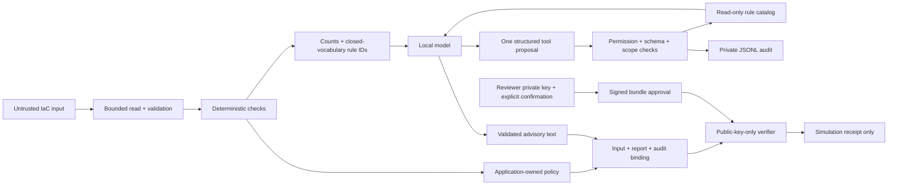

# Threat model

## Assets and trust boundaries

The assets are infrastructure input confidentiality, integrity of findings and policy,
auditability of model capabilities, and integrity of approvals. Trusted components
are the installed Python package, dependencies, application setup, local Ollama
service, reviewer signing workstation, and independently provisioned public key.
Repository owners and GitHub environment administrators remain trusted authorities.

Terraform plans, YAML, resource identifiers, model text, proposed tool names and
arguments, approval files, and downloaded workflow artifacts are untrusted data.

## Threats, controls, and limits

| Threat | Implemented control | Limit |
| --- | --- | --- |
| Prompt instructions in tags/annotations | No raw plan values, identifiers, tags or annotations enter the model context | A compromised local provider is outside the trust boundary |
| Model requests shell/apply/approval | Dispatcher allowlist grants the model only `lookup_rules` | No OS sandbox; arbitrary malicious Python can bypass this class |
| Model requests unrelated rules | Lookup IDs must be a subset of the active assessment context | Catalog text and rules remain trusted application code |
| Infinite agent loop or runaway requests | One tool proposal and at most two model HTTP requests, no automatic retries | Socket-operation timeouts are not a hard overall wall-clock deadline |
| Invalid output or unavailable inference | Schema validation and generic audited failure; never replace failed real inference with fake | Schema-valid language can still be inaccurate |
| Missing/unknown analysis becomes a pass | Explicit coverage gaps produce error; AI is skipped on incomplete analysis | Four narrow checks only; complete means complete within this scope |
| Secret leakage through telemetry | Validated counts/IDs and digests only; fixed error codes; no raw exceptions/prompts | Reports retain resource identifiers and must be handled as private |
| Input path manipulation | Trusted setup binds one input; bounded regular-file reads; final symlink rejected | Parent directories and same-user processes must be trusted; 1 MiB limit |
| YAML constructors, alias expansion, duplicate keys | SafeLoader subclass rejects aliases, duplicate/non-string keys, unsupported tags and >128 documents | Deep nesting fails the review rather than being interpreted |
| Logging fails silently | Persist start before execution and completion before returning a result | Partial writes can leave an incomplete final record; logs are not immutable |
| Forged or modified approval | Ed25519 verification with an independently configured public key | Key provisioning, storage and revocation are operator responsibilities |
| Approved input/report/audit changes | Signature binds exact input, report bytes and audit bytes; deterministic reanalysis | A signature attests to the bundle, not the completeness of all security rules |
| Reused or expired approval | 30-minute local approval, maximum 1-hour validity, exclusive simulation receipt | Replay protection is local to the protected run directory, not a distributed ledger |
| Report HTML injection | Escaped text, no scripts/resources, restrictive CSP | Any future rich HTML provider content needs a separate review |
| Privileged untrusted PR workflow | Ordinary `pull_request` CI, read-only token, immutable action pins, no secrets | Code/dependency execution still occurs on an ephemeral hosted runner |
| Unconfigured GitHub approval environment | Manual main-only demo inspects actual required-reviewer rules before proceeding | Environment policies and hosted waiting gate verified; human decision required |

## Identity separation

The pipeline may read its bound input and invoke the explanation provider. The
model may request only known rule descriptions for the active assessment. It cannot
read arbitrary files, write reports, obtain credentials, sign approvals, or call the
simulation gate. The public-key verifier needs no signing secret. In the local demo,
all processes share one workstation; for meaningful production isolation, reviewer
keys and execution identities belong on separately controlled hosts/services.

The GitHub demo uses platform environment approval instead of local keys. The
default independent preflight requires a nonempty required-reviewer rule and prevents self-review;
the protected job verifies the exact bundle digest from the review job. No cloud
identity or `id-token: write` permission is granted. This is not an AWS/Azure OIDC
deployment implementation.

## Residual risks and observed model behavior

A small local model can overstate severity or hallucinate broad safety claims.
Live evaluation exposed unreliable output on incomplete evidence, so incomplete
reviews now stop before inference. For complete reviews, text is still advisory:
severities, findings, and decisions come from code. Temperature/seed settings do not
guarantee identical output across runtimes or mutable model tags.

The native adapter talks only to loopback `127.0.0.1:11434`. The company gateway
adapter permits authenticated HTTPS only to exact hostnames from the trusted
`GUARD_ALLOWED_AI_HOSTS` environment setting; HTTP is literal-loopback-only with
no credentials. Both transports avoid proxies and redirects. Configuration cannot
read arbitrary credential environment variables, add arbitrary headers, or load
Python plugins. The gateway reads only `GUARD_AI_TOKEN`.

Only counts, known IDs, and trusted catalog descriptions cross the provider
boundary. Switching providers preserves the shared worker, tool scope, policy and
approval contracts. The response still requires local validation in explicit
JSON-only mode. Tokens are not auto-renewed; native cloud authentication SDKs and
OIDC acquisition are outside this increment. Keep token-bearing CI execution on
trusted code and provision only its provider identity. Operators must control the
provider's own network configuration; the app does not install an OS egress firewall.

The only deployment outcome is a JSON receipt declaring zero infrastructure
operations. Real apply support requires a separate threat model, short-lived cloud
identities, immutable artifact storage, authenticated approval, protected execution,
revocation, durable audit storage, and integration testing against disposable accounts.

## Single-person demonstration mode

`solo-demo` is an explicit exception for synthetic fixtures, isolated in
`security-review-solo-demo`. It requires the named repository-owner reviewer but
permits that person to approve their own test run. Default `independent` mode uses
`security-review` and still requires self-review prevention. Namespace/policy checks
prevent substituting the relaxed environment for the default gate. The solo verifier
accepts only the exact known fixture and simulated inference, and its receipt records
that self-review was permitted. This mode demonstrates human approval, not independent
two-person authorization, and must not be used as a production change-approval model.
